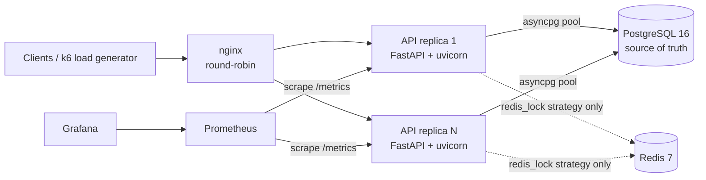
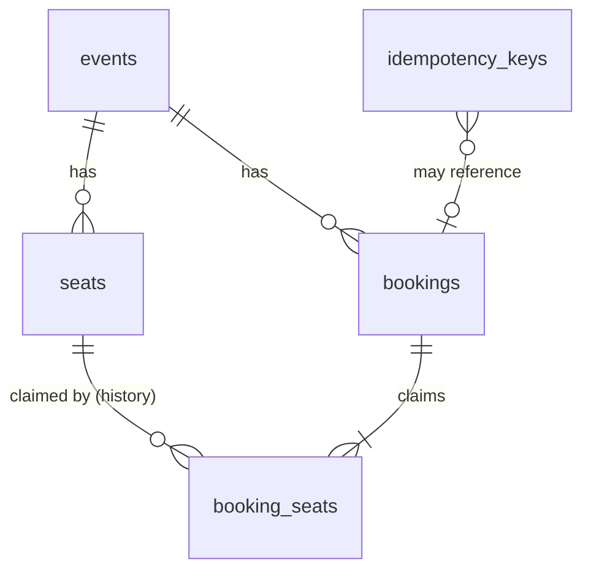
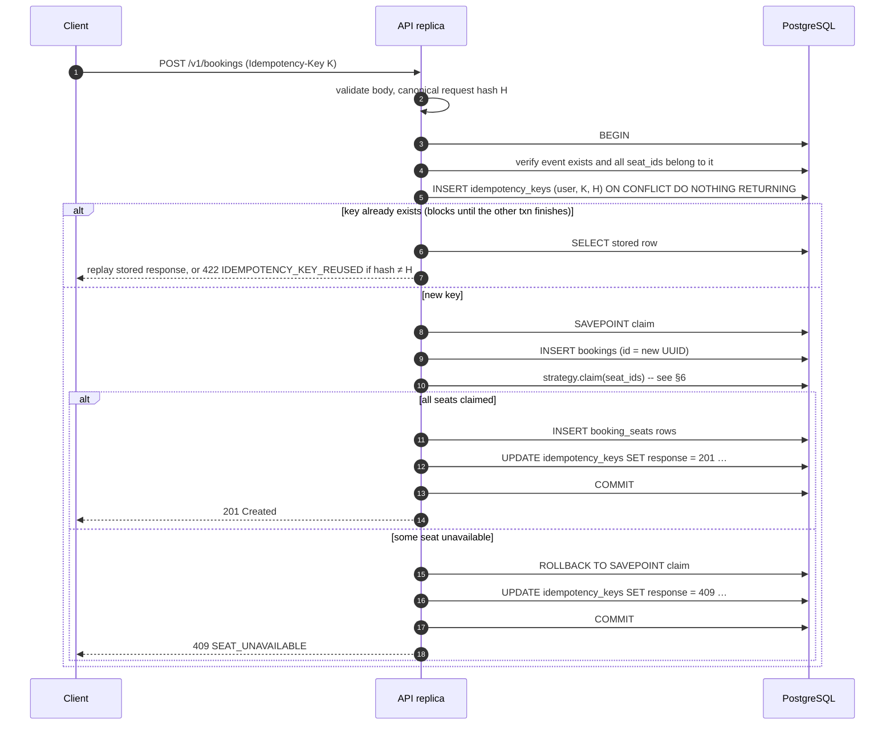

# DistriBook — System Design

| | |
|---|---|
| **Status** | Draft for review |
| **Last updated** | 2026-10-16 |
| **Related** | [Requirements](requirements.md) · [ADRs](adr/) |

## 1. Overview

DistriBook is a stateless HTTP API in front of PostgreSQL. **PostgreSQL is the single source of
truth.** Every rule that must never be broken is enforced by a database transaction and, as a final
safety net, by a database constraint. The application code is not trusted to enforce these rules on its own.

How the booking race is handled is a **pluggable strategy**, so different concurrency-control
techniques can run behind the same API, under the same tests and the same workloads, and be compared.
Redis is used by only one strategy, and only to reduce load on the database. It never decides whether a booking is correct.

## 2. Architecture



| Component | Responsibility | State |
|---|---|---|
| nginx | Spreads requests across API replicas; one fixed entry point | none |
| API replica | Validation, idempotency, transaction orchestration, strategy execution | **none** (stateless) |
| PostgreSQL | Durable state, transactions, row locks, constraints | all durable state |
| Redis | Short-lived per-seat locks used by the `redis_lock` strategy | ephemeral, disposable |
| Prometheus / Grafana | Metrics collection and dashboards (optional compose profile) | metrics only |

**Why several replicas even on one machine?** With one process, an in-memory lock or `asyncio.Lock`
can *appear* to solve the race. Running at least two replicas makes any such shortcut fail visibly
and forces the solution to work across processes, which is the realistic setting.

### Code structure

```
src/distribook/
├── main.py            # app factory, lifespan (pool start/stop, graceful shutdown)
├── config.py          # pydantic-settings; every setting comes from the environment
├── api/               # routers: events, seats, bookings, health; problem+json error handlers
├── domain/            # request/response models, domain errors
├── services/          # booking & cancellation orchestration, idempotency, retry policy
├── strategies/        # naive, conditional, pessimistic, pessimistic_nowait, redis_lock
├── db/                # engine/pool, SQLAlchemy Core table definitions
└── observability/     # JSON logging, request IDs, Prometheus metrics
migrations/            # Alembic
tests/{unit,integration,concurrency,failure}/
load/k6/               # k6 scenarios
benchmarks/            # runner, raw results, analysis + charts
deploy/                # nginx.conf, prometheus.yml, grafana provisioning
```

Layering: `api → services → strategies → db`. Routers contain no SQL. Strategies contain only the
code that claims seats, so each one can be swapped and reviewed in isolation.

## 3. Data model



```sql
CREATE TYPE seat_status    AS ENUM ('AVAILABLE', 'BOOKED');
CREATE TYPE booking_status AS ENUM ('CONFIRMED', 'CANCELLED');

CREATE TABLE events (
    id          bigint GENERATED ALWAYS AS IDENTITY PRIMARY KEY,
    name        text        NOT NULL CHECK (length(name) BETWEEN 1 AND 200),
    starts_at   timestamptz NOT NULL,
    created_at  timestamptz NOT NULL DEFAULT now()
);

CREATE TABLE bookings (
    id            uuid PRIMARY KEY,
    event_id      bigint         NOT NULL REFERENCES events (id),
    user_id       text           NOT NULL CHECK (length(user_id) BETWEEN 1 AND 128),
    status        booking_status NOT NULL DEFAULT 'CONFIRMED',
    created_at    timestamptz    NOT NULL DEFAULT now(),
    cancelled_at  timestamptz,
    UNIQUE (id, event_id),                                   -- target of composite FK (INV-5)
    CHECK ((status = 'CANCELLED') = (cancelled_at IS NOT NULL))
);

CREATE TABLE seats (
    id          bigint GENERATED ALWAYS AS IDENTITY PRIMARY KEY,
    event_id    bigint      NOT NULL REFERENCES events (id),
    label       text        NOT NULL,
    status      seat_status NOT NULL DEFAULT 'AVAILABLE',
    booking_id  uuid        REFERENCES bookings (id),
    version     integer     NOT NULL DEFAULT 0,
    updated_at  timestamptz NOT NULL DEFAULT now(),
    UNIQUE (event_id, label),
    UNIQUE (event_id, id),                                   -- target of composite FK (INV-5)
    CHECK ((status = 'BOOKED') = (booking_id IS NOT NULL))   -- INV-3, row-local half
);
CREATE INDEX seats_event_status_idx ON seats (event_id, status, id);
CREATE INDEX seats_booking_idx      ON seats (booking_id) WHERE booking_id IS NOT NULL;

-- Append-only claim history. Releasing a seat sets released_at; rows are never deleted.
CREATE TABLE booking_seats (
    booking_id   uuid        NOT NULL,
    event_id     bigint      NOT NULL,
    seat_id      bigint      NOT NULL,
    claimed_at   timestamptz NOT NULL DEFAULT now(),
    released_at  timestamptz,
    PRIMARY KEY (booking_id, seat_id),
    FOREIGN KEY (booking_id, event_id) REFERENCES bookings (id, event_id),  -- INV-5
    FOREIGN KEY (event_id, seat_id)    REFERENCES seats (event_id, id)      -- INV-5
);
-- THE SAFETY NET (INV-1): at most one unreleased claim per seat, enforced by the database.
CREATE UNIQUE INDEX booking_seats_one_active_claim
    ON booking_seats (seat_id) WHERE released_at IS NULL;

CREATE TABLE idempotency_keys (
    user_id        text        NOT NULL,
    key            text        NOT NULL CHECK (length(key) BETWEEN 1 AND 255),
    request_hash   bytea       NOT NULL,          -- SHA-256 of the canonical request body
    response_code  smallint,                      -- NULL until the outcome is recorded
    response_body  jsonb,
    booking_id     uuid        REFERENCES bookings (id),
    created_at     timestamptz NOT NULL DEFAULT now(),
    expires_at     timestamptz NOT NULL,
    PRIMARY KEY (user_id, key)
);
CREATE INDEX idempotency_keys_expiry_idx ON idempotency_keys (expires_at);
```

**Design notes**

- `seats.status` / `seats.booking_id` are the **fast path**: one row to read or update, indexed for
  "list available seats". `booking_seats` is the **record of who claimed what**, and its partial unique
  index is the **safety net**. Both are written in the same transaction, and INV-3 checks that they agree.
- The composite foreign keys mean the database itself rejects a booking that claims another event's seat.
- Booking IDs are random UUIDs, so they can't be guessed or enumerated. Event and seat IDs are
  sequential `bigint`s, which is fine because they aren't secret.
- `version` is incremented on every seat state change. It is used for observability and makes
  "did this seat change under me?" checks cheap.

## 4. API

Base path `/v1`. Errors use [RFC 9457](https://www.rfc-editor.org/rfc/rfc9457) `application/problem+json`
with a stable machine-readable `code` field.

| Method & path | Purpose | Success | Notable errors |
|---|---|---|---|
| `POST /v1/events` | Create event + seat grid (`rows` ≤ 100, `seats_per_row` ≤ 100) | `201` | `422` |
| `GET /v1/events/{event_id}` | Event with seat counts by status | `200` | `404` |
| `GET /v1/events/{event_id}/seats?status=&limit=&after_id=` | List seats, keyset pagination | `200` | `404`, `422` |
| `GET /v1/seats/{seat_id}` | One seat | `200` | `404` |
| `POST /v1/bookings` (header `Idempotency-Key`) | Book 1–10 seats, all-or-nothing | `201`; `201` + `Idempotent-Replayed: true` on replay | `400`, `404`, `409`, `422`, `503` |
| `GET /v1/bookings/{booking_id}` | Booking with its seats | `200` | `404` |
| `POST /v1/bookings/{booking_id}/cancel` | Cancel; idempotent | `200` | `404` |
| `GET /healthz` | Liveness: process is up | `200` | — |
| `GET /readyz` | Readiness: DB reachable (and Redis, if configured) | `200` | `503` |
| `GET /metrics` | Prometheus exposition | `200` | — |

### `POST /v1/bookings`

```http
POST /v1/bookings
Idempotency-Key: 3f1c2a9e-8d7b-4c55-a8a4-0d6f1e2b7c90
Content-Type: application/json

{ "event_id": 42, "user_id": "u-501", "seat_ids": [1031, 1032] }
```

```http
HTTP/1.1 201 Created
Location: /v1/bookings/6b0f9a43-5f0e-4f0a-9a3e-6a51d3c2b1f7

{ "id": "6b0f9a43-…", "event_id": 42, "user_id": "u-501", "status": "CONFIRMED",
  "seats": [{ "id": 1031, "label": "K11" }, { "id": 1032, "label": "K12" }],
  "created_at": "2026-10-16T10:15:02.113Z" }
```

| Status | `code` | Meaning | Client should | Stored for replay? |
|---|---|---|---|---|
| 201 | — | Booked | — | yes |
| 400 | `IDEMPOTENCY_KEY_MISSING` / `_INVALID` | Header missing or malformed | fix request | no |
| 404 | `EVENT_NOT_FOUND` | Unknown event | fix request | no |
| 409 | `SEAT_UNAVAILABLE` | One or more seats already booked; body lists `unavailable_seat_ids` | choose other seats, **new key** | **yes** |
| 409 | `SEAT_CONTENDED` | Seat is locked by an in-flight request (only `nowait` / `redis_lock` strategies, or lock wait timed out) | retry, same key | no |
| 409 | `REQUEST_IN_PROGRESS` | The original request with this key is still running and outlasted `lock_timeout` | retry, same key | no |
| 422 | `VALIDATION_ERROR` | Bad body: 0 or > 10 seats, duplicate IDs, … | fix request | no |
| 422 | `INVALID_SEATS` | Seat IDs not in this event | fix request | no |
| 422 | `IDEMPOTENCY_KEY_REUSED` | Same key, different body | use a new key | n/a |
| 503 | `SERVICE_OVERLOADED` / `DATABASE_UNAVAILABLE` | Load shed or dependency down; `Retry-After` set | retry with backoff, same key | no |

**Rule:** only *final* business outcomes are stored for replay. Temporary outcomes (`SEAT_CONTENDED`,
`503`, `5xx`) are not stored, so retrying with the same key gets a fresh attempt.

## 5. The booking transaction

All strategies run inside one orchestration in `services/booking_service.py`. The database uses
PostgreSQL's default **READ COMMITTED** isolation level. Correctness comes from row locks and
conditional writes, not from a stricter isolation level (see [ADR-0002](adr/0002-pluggable-concurrency-strategies.md)).



Why this shape:

- **The idempotency row is written in the same transaction as the booking.** If two requests
  with the same key arrive together, PostgreSQL makes the second `INSERT … ON CONFLICT` wait for the
  first transaction to finish. If the first commits, the second replays its stored response. If the
  first rolls back (crash, error), the second goes ahead as a fresh attempt. No "in-progress" state
  and no lock that could be left behind (INV-4). It must be `DO NOTHING`: `DO UPDATE` would lock
  the existing row and make duplicates queue behind each other, which the concurrency suite
  caught. See [ADR-0004](adr/0004-idempotency-in-the-booking-transaction.md).
- **The savepoint** lets a lost race undo the half-built booking but still commit the `409`
  outcome against the key, so replays are deterministic.
- **The client gets `201` only after `COMMIT` succeeds** (INV-6). If the connection drops during
  `COMMIT`, the outcome is unknown, so the client gets `503`. Its retry with the same key then
  either replays the committed `201` or books for the first time. Either way it's correct.

### Global lock ordering (deadlock prevention)

> Every transaction that locks more than one seat row locks them in ascending `seats.id` order.
> Cancellation locks the `bookings` row first, then its seats in ascending order. Booking never
> locks an existing `bookings` row.

So two transactions can never each hold a lock the other is waiting for. As an extra safeguard,
`deadlock_detected (40P01)` and `serialization_failure (40001)` are retried up to 3 times with
jittered backoff, and counted in `distribook_txn_retries_total`. That counter is expected to stay at **zero**.

### Timeouts and load shedding

| Setting | Default | Effect when exceeded |
|---|---|---|
| Pool checkout timeout | 2 s | `503 SERVICE_OVERLOADED`, `Retry-After: 1` |
| `lock_timeout` | 1 s | `409 SEAT_CONTENDED` (retryable) |
| `statement_timeout` | 2 s | `503`, transaction rolled back |
| `idle_in_transaction_session_timeout` | 5 s | server kills stuck sessions |
| nginx `proxy_read_timeout` | 5 s | `504` (should never happen if the limits above hold) |

Connection budget: `replicas × pool_size ≤ 0.8 × max_connections`. Default 2 × 10 = 20 of 100.

## 6. Concurrency strategies

Selected per deployment with `DISTRIBOOK_BOOKING_STRATEGY`, not per request. Benchmarks restart the
stack with each value. The interface:

```python
class BookingStrategy(Protocol):
    async def claim(
        self, conn: AsyncConnection, *, event_id: int, seat_ids: Sequence[int], booking_id: UUID
    ) -> ClaimResult: ...
```

### 6.1 `conditional` — default

The availability check and the write happen in **one statement**. The CTE locks only *available*
target rows, in ID order:

```sql
WITH target AS (
    SELECT id FROM seats
    WHERE event_id = :event_id AND id = ANY(:seat_ids) AND status = 'AVAILABLE'
    ORDER BY id
    FOR UPDATE
)
UPDATE seats s
SET status = 'BOOKED', booking_id = :booking_id, version = s.version + 1, updated_at = now()
FROM target
WHERE s.id = target.id
RETURNING s.id;
```

If fewer rows come back than were requested, the claim failed: roll back to the savepoint and
report the missing IDs. Under READ COMMITTED, a transaction that was waiting for a row lock
**re-checks** `status = 'AVAILABLE'` against the newly committed row once the lock is released. A
loser therefore sees the seat as `BOOKED` and skips it, and can never overwrite the winner.

### 6.2 `pessimistic` / `pessimistic_nowait`

```sql
SELECT id, status FROM seats
WHERE event_id = :event_id AND id = ANY(:seat_ids)
ORDER BY id
FOR UPDATE;            -- pessimistic_nowait: FOR UPDATE NOWAIT
```

The application checks the statuses, then runs a plain `UPDATE`. This is the textbook "lock, check,
write" pattern. It takes one extra round trip while holding the locks, which the benchmarks will
measure. With `NOWAIT`, a busy seat fails straight away with `55P03`, which maps to `409 SEAT_CONTENDED`.
Losers give up immediately instead of queueing for the lock.

### 6.3 `redis_lock`

1. Before taking a DB connection: for each seat in ascending order,
   `SET lock:seat:{id} <token> NX PX 2000`. If any of these fails, release the locks already held
   (compare-and-delete Lua script) and return `409 SEAT_CONTENDED`.
2. Run the transaction above using the `conditional` claim.
3. Release the locks in `finally`.

The point is that **losers are turned away without ever using a database connection**, which protects
the pool when a hot seat draws heavy contention. Correctness never depends on Redis
([ADR-0003](adr/0003-redis-is-an-optimisation-not-a-correctness-dependency.md)). If a lock expires,
or Redis fails over and two requests both reach the database, the conditional write still lets only
one of them win. The conditional write acts as the fencing token. If Redis is unreachable, the
strategy skips the lock step and falls back to `conditional` (`distribook_redis_fallback_total`)
instead of refusing requests.

### 6.4 `naive` — deliberately unsafe, test-only

Read the seat statuses without a lock, then if they look available, write them without any condition.
It can only be enabled with `DISTRIBOOK_ENABLE_UNSAFE_STRATEGIES=true`, and startup **refuses** it when
`DISTRIBOOK_ENV=production`. It exists to prove the tests can detect a race:

- naive **with** the safety-net index: the index catches the race. The loser gets a unique
  violation, which maps to `409`. This shows the safety net working.
- naive **without** the index (the test drops it): the contention test **must find duplicate bookings**.
  If it didn't, the test couldn't catch a race and its passes for the other strategies would mean nothing.

### 6.5 What the benchmarks are expected to show

These are hypotheses to test, **not** results:

| Strategy | Hot single seat | Many independent seats |
|---|---|---|
| conditional | Losers queue on the row lock and hold pool connections, so tail latency grows with contention | Best: one statement per claim |
| pessimistic | Like conditional, plus a round trip while locked | Slightly slower than conditional |
| pessimistic_nowait | Losers fail immediately, so the tail stays low | ≈ conditional |
| redis_lock | Losers never touch the DB, so the pool is protected | Extra Redis round trips: slower |

## 7. Cancellation

```sql
BEGIN;
SELECT status, user_id FROM bookings WHERE id = :id FOR UPDATE;    -- 404 if missing or user mismatch
-- already CANCELLED → COMMIT, return 200 with current state (idempotent)
SELECT id FROM seats WHERE booking_id = :id ORDER BY id FOR UPDATE; -- lock order rule
UPDATE seats SET status = 'AVAILABLE', booking_id = NULL, version = version + 1, updated_at = now()
 WHERE booking_id = :id;
UPDATE booking_seats SET released_at = now() WHERE booking_id = :id AND released_at IS NULL;
UPDATE bookings SET status = 'CANCELLED', cancelled_at = now() WHERE id = :id;
COMMIT;
```

The cancel request body carries `user_id`. If it doesn't match the booking's owner, the response is
`404`, not `403`, so callers can't learn which booking IDs exist.

## 8. Failure modes

| Failure | Behaviour | Why it is safe |
|---|---|---|
| API process killed mid-transaction | PostgreSQL rolls back when the connection drops | Nothing is visible until `COMMIT` |
| Connection lost during `COMMIT` | Client gets `503`; outcome unknown | Retry with the same key replays the committed result or books once |
| Client times out and retries | Same key → replay or wait for the in-flight original | INV-4 |
| PostgreSQL down | `/readyz` → `503`, nginx stops routing to the replica; requests get `503 DATABASE_UNAVAILABLE` quickly | Fail closed: no booking without the source of truth |
| PostgreSQL restarts | Pool drops dead connections (`pool_pre_ping`), reconnects | Committed data is durable (WAL) |
| Redis down | `redis_lock` falls back to `conditional` | Redis is not part of correctness |
| Redis lock expires mid-request | A second request may reach the DB | Conditional write still lets only one win |
| Hot seat / overload | Lock timeout → `409 SEAT_CONTENDED`; pool timeout → `503` + `Retry-After` | Bounded latency instead of piling up |
| Deadlock | Prevented by lock ordering; retried if it ever happens | Counter shows it never happens |
| Two replicas run cleanup | `pg_try_advisory_lock` lets only one run | — |

## 9. Verifying correctness

### Invariant check

Run at the end of every concurrency test and every benchmark run. Every query must return **zero rows**:

```sql
-- INV-1: no seat with more than one active claim
SELECT seat_id FROM booking_seats WHERE released_at IS NULL GROUP BY seat_id HAVING count(*) > 1;

-- INV-3: seats table agrees with the claim history
SELECT s.id FROM seats s
LEFT JOIN booking_seats bs ON bs.seat_id = s.id AND bs.released_at IS NULL
WHERE (s.status = 'BOOKED')    IS DISTINCT FROM (bs.booking_id IS NOT NULL)
   OR (s.status = 'BOOKED' AND s.booking_id IS DISTINCT FROM bs.booking_id);

-- INV-2/INV-3: every booking has seats; confirmed ones hold all of them, cancelled ones hold none
SELECT b.id FROM bookings b
LEFT JOIN booking_seats bs ON bs.booking_id = b.id
GROUP BY b.id, b.status
HAVING count(bs.seat_id) = 0
    OR (b.status = 'CONFIRMED' AND bool_or(bs.released_at IS NOT NULL))
    OR (b.status = 'CANCELLED' AND bool_or(bs.released_at IS NULL));

-- INV-4: at most one booking per idempotency key (structurally true; checked anyway)
SELECT user_id, key FROM idempotency_keys WHERE booking_id IS NOT NULL
GROUP BY user_id, key HAVING count(DISTINCT booking_id) > 1;
```

### Test pyramid

| Layer | Runs against | Examples |
|---|---|---|
| Unit | nothing external | request hashing, validation, error mapping, retry policy |
| Integration | real PostgreSQL (and Redis) | each endpoint, each status code, cancellation, pagination |
| Concurrency | real PostgreSQL, many connections | 500 requests released at the same instant (`asyncio.Barrier`) for one seat; overlapping multi-seat requests (deadlock check); duplicate idempotency keys at the same instant; book-vs-cancel races. **Run for every safe strategy, plus the naive "can the test catch it?" check.** |
| Failure | real PostgreSQL via Docker | connection terminated mid-transaction (`pg_terminate_backend`), DB restart, Redis stopped |
| Load | full compose stack via nginx | §10 |

## 10. Load testing and benchmarking (summary)

Full method: `docs/benchmark-methodology.md` (written in Phase 5).

- **Tool:** k6, run in Docker, using the **open-model** `constant-arrival-rate` executor. New requests
  arrive on schedule whether or not the server keeps up. A closed model, where each virtual user waits
  for its previous reply, hides queueing delay and makes tail latency look better than it is
  ("coordinated omission"). See [ADR-0006](adr/0006-k6-open-model-load-generation.md).
- **Workloads:** `hot_seat` (all requests target one seat), `uniform` (random seats across 10,000),
  `zipf_mixed` (80 % reads / 20 % writes, popular seats hit far more often than others), `ramp`
  (step the arrival rate up until it saturates).
- **Matrix:** every safe strategy × every workload × 3 repeats. Report the median and the min–max.
- **Recorded per run:** p50 / p90 / p95 / p99 / p99.9 latency, throughput, outcome breakdown
  (201 / 409 / 503 / other), CPU and memory per container, DB pool usage, invariant check result,
  machine specs, Docker resource limits, software versions, git SHA. Raw k6 output is committed.
- **Honesty:** results come from a single machine running Docker Desktop. They show relative behaviour
  and where the bottleneck is, not production capacity.

## 11. Observability

- **Logs:** one JSON line per request with `request_id` (taken from an incoming `X-Request-ID`
  or generated), route, status, duration and strategy. Booking outcomes are logged with `booking_id`.
  User data is limited to `user_id`.
- **Metrics:**
  - `http_request_duration_seconds{route,method,status}` (histogram)
  - `distribook_booking_attempts_total{strategy,outcome}`
  - `distribook_txn_retries_total{reason}`
  - `distribook_db_pool_in_use`, `distribook_db_pool_wait_seconds`
  - `distribook_redis_fallback_total`
- **Process model:** one uvicorn worker per container. Scale by adding replicas, not workers. This
  avoids Prometheus multiprocess mode and keeps one process = one pool = one set of metrics
  ([ADR-0005](adr/0005-sqlalchemy-core-and-single-worker-containers.md)).

## 12. Deployment

`docker compose up` starts PostgreSQL → a one-shot `migrate` job (`alembic upgrade head`) → API
replicas (which wait for `migrate` to finish successfully) → nginx. Optional profiles add `redis`,
`observability` (Prometheus, Grafana) and `bench` (k6).

- Multi-stage image, slim Python 3.12 base, non-root user, no build tools in the final image.
- Health checks gate start-up order and nginx routing.
- `SIGTERM` → stop accepting requests, finish in-flight requests (≤ 10 s), close the pool.
- All configuration comes from environment variables. `.env.example` lists every setting and its default. No secrets are committed.

## 13. Scaling beyond one machine

What would change at real scale, and why the current design allows it:

1. **Partition by `event_id`.** A booking never spans events, so each event's data can live on one
   shard (e.g. Citus, or routing in the application) with no cross-shard transactions.
2. **Hot events.** A single seat row can only be written one transaction at a time, so a seat's
   throughput is roughly limited by how long its lock is held. For big on-sales, put a
   **virtual waiting room / admission queue** in front, so contention is turned away before it reaches the database.
3. **Read scaling.** Seat listings can be served from read replicas or a short-lived cache. Slightly
   stale availability is fine for display because the write path is always the authority.
4. **Idempotency table growth.** Partition it by time and drop old partitions instead of running
   `DELETE`s.
5. **Holds with expiry (stretch goal).** Add a `HELD` status with `held_until`, and claim with
   `WHERE status = 'AVAILABLE' OR (status = 'HELD' AND held_until < now())`. Expiry then happens
   automatically when a seat is next claimed, so a background sweeper only tidies the display and is
   never needed for correctness.
